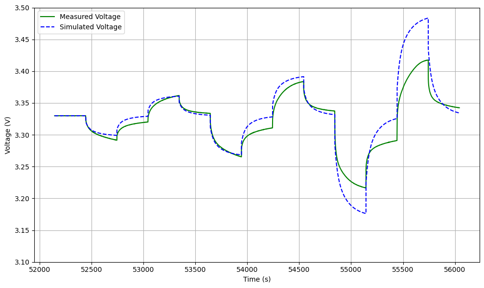
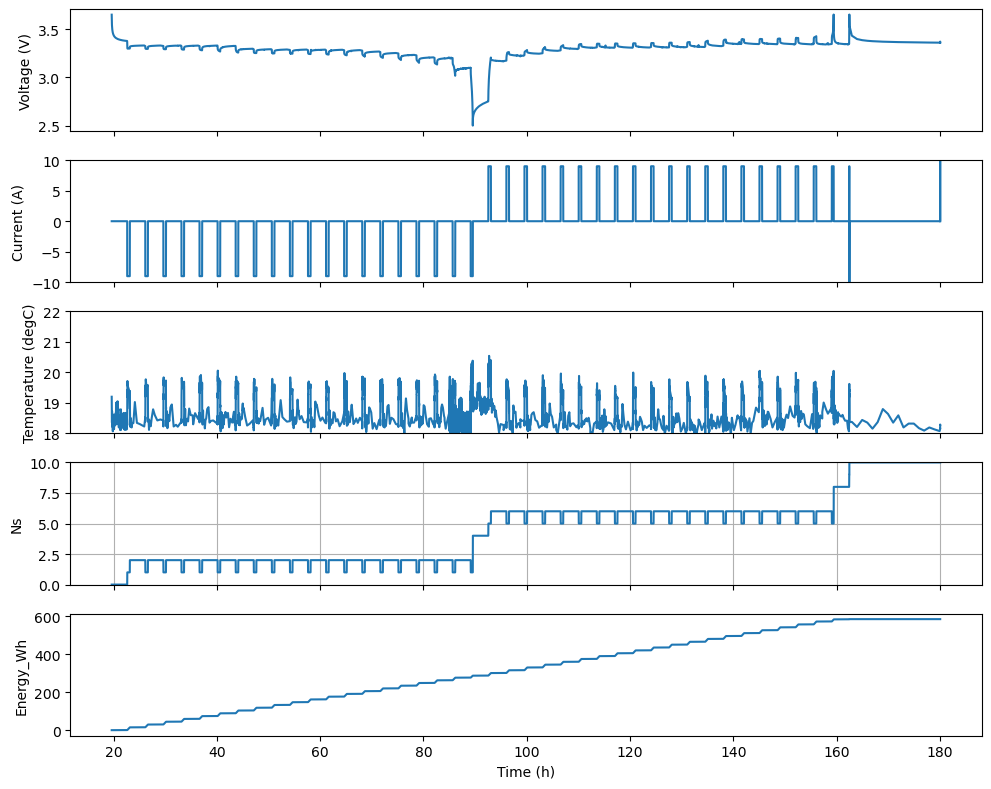
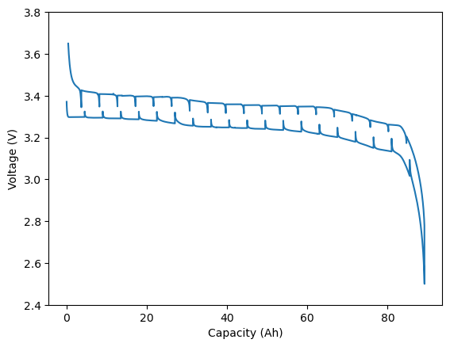
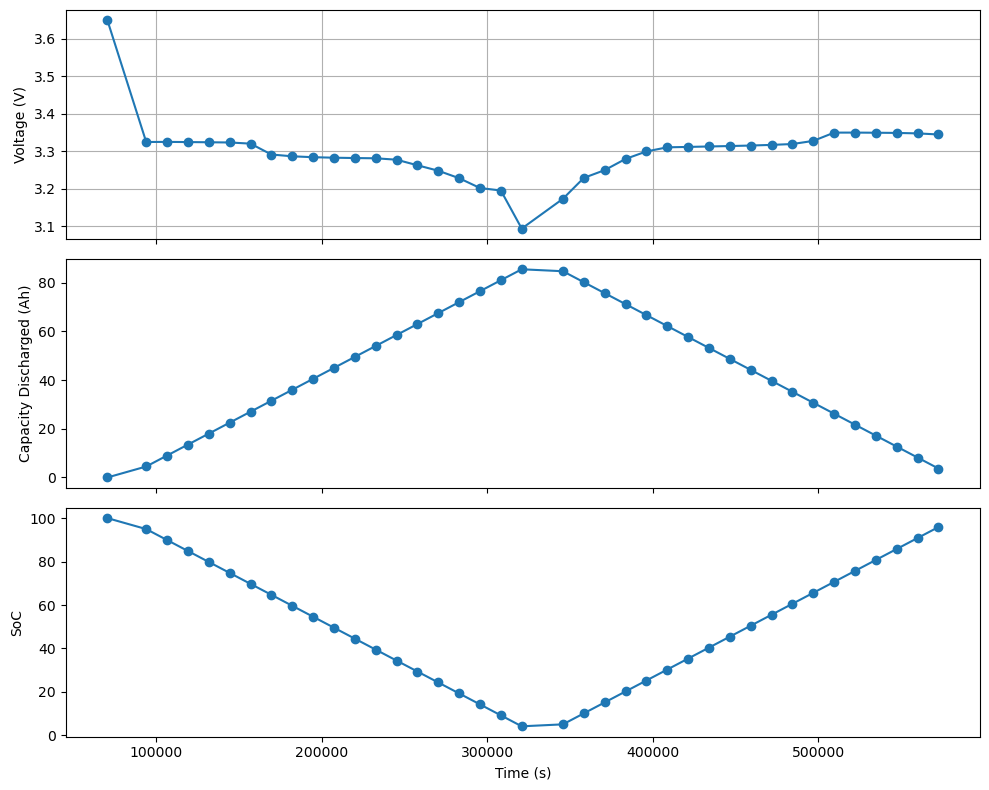
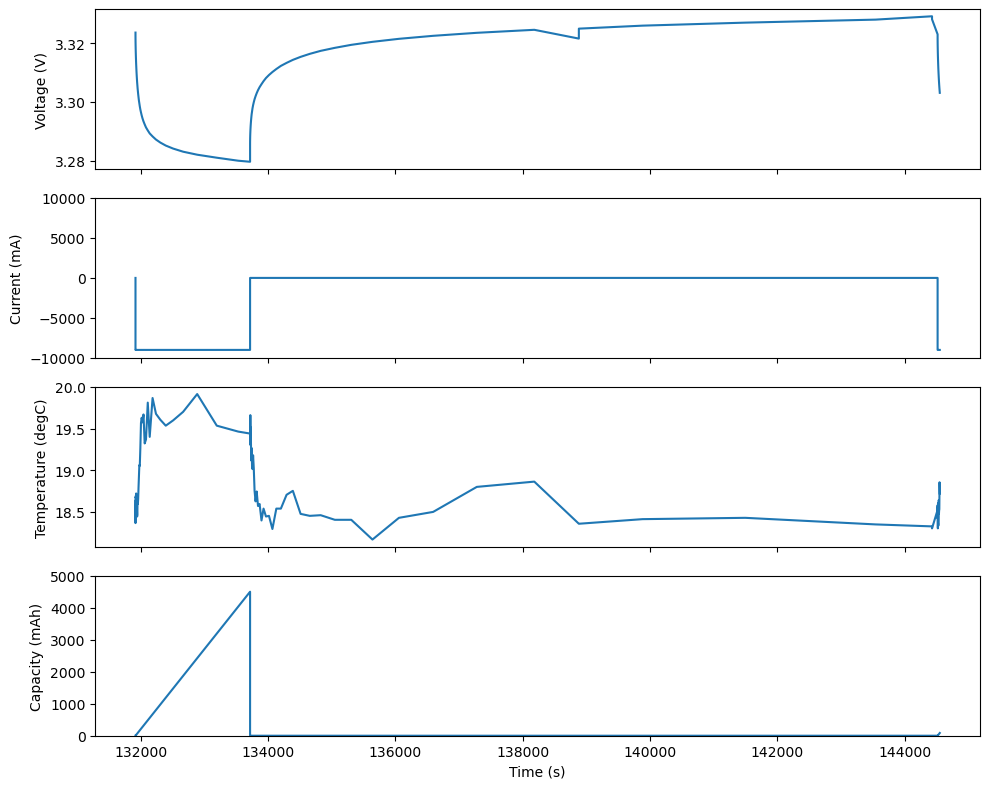
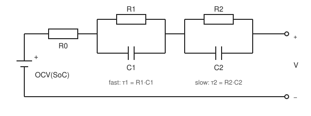
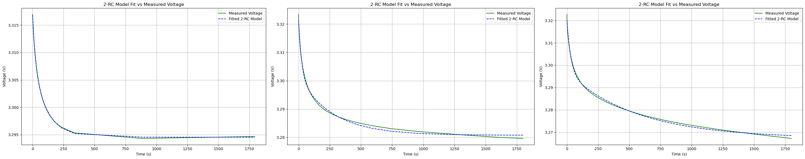
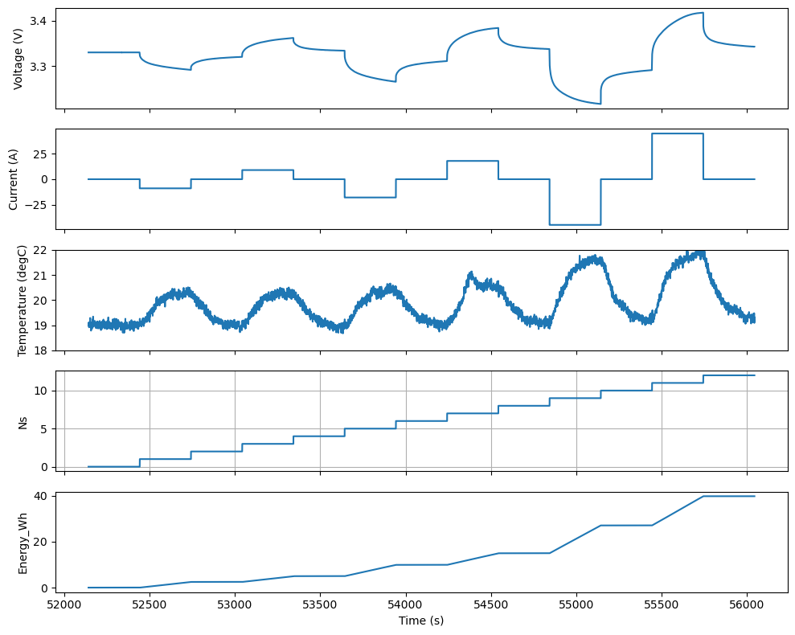

# LFP Cell Characterisation & 2-RC Equivalent-Circuit Model

Characterisation of a ~89 Ah LiFePO₄ (LFP) cell from lab cycling data, identification of a
**second-order (2-RC) equivalent-circuit model** by nonlinear least-squares fitting, and
validation of the model against an independent dynamic current profile.

*Completed as a technical assessment for a battery engineering role; results were presented to the interview panel.*



## Summary

| | |
|---|---|
| **Cell** | LiFePO₄, ~89 Ah / ~287 Wh (9 A, C/10 discharge) |
| **Method** | Pulse-relaxation analysis → DCIR → curve fit of 2-RC model → Euler-integrated simulation |
| **Model fit (single pulse)** | Near-exact fit of 30-min 9 A pulse responses at 95 %, 80 % and 75 % SoC |
| **Validation (unseen profile)** | **RMSE 23.6 mV, MAE 14.8 mV** using 95 % SoC parameters |
| **Key finding** | Model tracks low-current pulses well but over-predicts polarisation at high current (up to ±45 A), indicating current-dependent resistances |

## Approach

### 1. Data exploration & characterisation
The characterisation test is a ~7.5-day pulsed discharge/charge at ±9 A with rest periods
between pulses, logged with time, voltage, current, capacity, energy and temperature.



- **Capacity / energy:** 89.2 Ah and 287 Wh on discharge (mean 3.08 V); 88.8 Ah on charge (mean 3.27 V)
- **OCV–SoC curve** built from the rested voltage at the end of each rest period, SoC from coulomb counting
- **Charge/discharge voltage gap** (~0.15 V under load) from polarisation plus LFP's characteristic hysteresis on its flat plateau





### 2. DC internal resistance (DCIR)
DCIR = ΔV / ΔI at 10 s, 30 s, 60 s … after pulse onset of each 30-min, 9 A discharge pulse:



| SoC | DCIR 10 s | DCIR 30 s |
|---|---|---|
| ~95 % | 1.05 mΩ | 1.73 mΩ |
| ~80 % | 1.18 mΩ | 1.99 mΩ |
| ~75 % | 1.19 mΩ | 2.10 mΩ |

### 3. 2-RC model identification



```
V(t) = OCV − I·R0 − I·R1·(1 − e^(−t/τ1)) − I·R2·(1 − e^(−t/τ2))
```

R0 is fixed from the 10 s DCIR; the polarisation amplitudes (A = I·R) and time constants τ are
fitted with `scipy.optimize.curve_fit` on each 30-minute pulse, and R, C are back-calculated
(τ = R·C).


*Left to right: 95 %, 80 %, 75 % SoC*

| SoC | R0 (mΩ) | R1 (mΩ) | τ1 (s) | R2 (mΩ) | τ2 (s) |
|---|---|---|---|---|---|
| 95 % | 1.05 | 0.93 | 23 | 1.55 | 111 |
| 80 % | 1.18 | 2.22 | 25 | 2.28 | 277 |
| 75 % | 1.19 | 2.61 | 31 | 3.27 | 571 |

Two clearly separated time scales emerge: a fast process (τ1 ≈ 25 s, charge transfer / double layer)
and a slow process (τ2 ≈ 100–600 s, diffusion) that grows as SoC decreases.

### 4. Simulation & validation
The RC-branch ODE `dV_k/dt = (I·R_k − V_k)/τ_k` is integrated with forward Euler and
driven by the measured current of a separate validation profile: 5-minute discharge/charge pulses at
9, 18 and 45 A (C/10, C/5, C/2) separated by rests, starting at ~95 % SoC.



- **RMSE 23.6 mV, MAE 14.8 mV** over the full profile
- Excellent agreement at the low-amplitude pulses; error concentrates in the high-current pulses,
  where the model over-predicts the voltage swing

## Limitations & next steps
- **Constant OCV & single parameter set**: parameters from one SoC are applied to the whole profile.
  Next: SoC-dependent lookup tables for OCV, R and τ, updated by coulomb counting.
- **Current dependence**: fitted only at 9 A. The high-current overshoot suggests Butler–Volmer-like
  nonlinearity; fit at multiple C-rates.
- **Hysteresis and temperature** not modelled.
- **Estimation**: the identified model is a natural basis for an EKF/UKF SoC estimator.

## Repository
This repository contains the write-up and figures. The analysis notebook (Python: pandas, NumPy,
SciPy, Matplotlib) and the raw test data are not published. The data is proprietary; the code is
available on request.

## References
2-RC model formulation and comparable parameter sets:
- doi:[10.1109/PEDES56012.2022.10079988](https://doi.org/10.1109/PEDES56012.2022.10079988)
- doi:[10.1109/ACCESS.2022.3148528](https://doi.org/10.1109/ACCESS.2022.3148528)
- doi:[10.20944/preprints202101.0223.v1](https://doi.org/10.20944/preprints202101.0223.v1)
- doi:[10.1016/j.jpowsour.2020.229117](https://doi.org/10.1016/j.jpowsour.2020.229117) (3-RC parameters for a 90 Ah LFP cell)
- [abhy-kumar/battery-modelling-project](https://github.com/abhy-kumar/battery-modelling-project), [TUMFTM/2RC_ECM](https://github.com/TUMFTM/2RC_ECM), [NREL/thevenin](https://github.com/NREL/thevenin)
